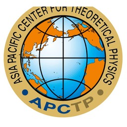

Visiting APCTP in Pohang, South Korea, and gave an invited talk on the phenomenology of anomaly-free axion-like particles at the workshop _New Perspectives on Flavor and Symmetries in Particle Physics_.
